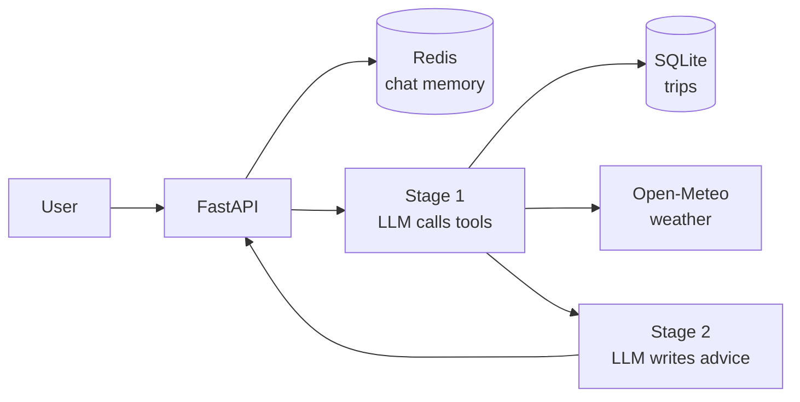
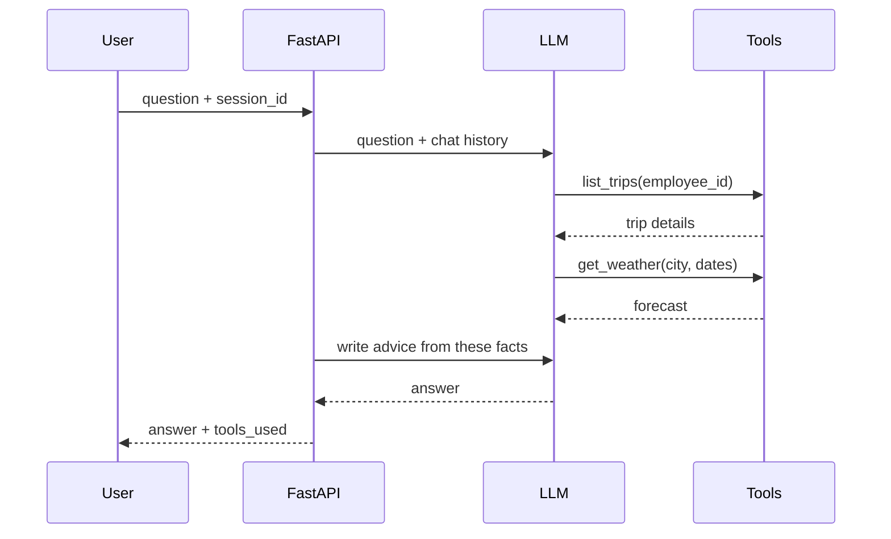

# Travel and Weather Advisory Assistant

A small FastAPI app that helps employees get ready for business trips. You save a trip, ask a question like "What weather should I expect in Jaipur?", and the assistant looks up the trip, fetches the live forecast, and replies with short travel advice. It remembers the conversation, so you can ask follow-up questions without repeating the city.

**Built with:** FastAPI, SQLite, Redis, LangChain, Open-Meteo weather API, and an LLM (DeepSeek V4.1 Flash via the Goedel API, or a local Ollama model).

## How it works



When a question comes in on `/chat`:

1. The app loads the earlier messages for that `session_id` from Redis.
2. **Stage 1:** the LLM decides which tools to call. It looks up the trip with `list_trips` or `get_trip`, then gets the forecast with `get_weather`. It keeps calling tools until it has what it needs.
3. **Stage 2:** the LLM writes the answer using only what the tools returned: the destination, a weather summary, and 3-4 packing tips. If a tool returned an error, it says the data is unavailable instead of guessing.
4. The question and answer are saved to Redis and the answer is sent back, along with `tools_used`, the list of tools that were called.

### Agent communication



## Project files

```
app/
  config.py     reads settings from .env
  db.py         SQLite table and queries
  schemas.py    checks the input (required fields, valid dates)
  weather.py    Open-Meteo city lookup and forecast
  tools.py      the tools the LLM can call
  memory.py     chat history in Redis
  assistant.py  the two stages
  main.py       API endpoints
scripts/init_db.py   creates the table and adds sample trips
evidence/            screenshots of the tests
```

## Setup

**1. Install packages**
```powershell
python -m venv venv
.\venv\Scripts\Activate.ps1
pip install -r requirements.txt
```

**2. Create `.env`** (copy `.env.example` and fill it in)
```
LLM_PROVIDER=goedel
GOEDEL_API_KEY=your-key-here
GOEDEL_BASE_URL=https://api.goedelmachines.com/v1
GOEDEL_MODEL=deepseek/deepseek-v4.1-flash
SQLITE_PATH=trips.db
REDIS_URL=redis://localhost:6379/0
SESSION_TTL_SECONDS=86400
SESSION_MAX_MESSAGES=10
```
To use Ollama instead, set `LLM_PROVIDER=ollama`, `OLLAMA_MODEL=qwen2.5:3b` and `OLLAMA_BASE_URL=http://localhost:11434`.

**3. Start Redis** (Docker is used only for Redis)
```powershell
docker run -d --name redis -p 6379:6379 redis:7   # first time
docker start redis                                # later
```

**4. Create the database with sample trips**
```powershell
python -m scripts.init_db
```
This adds 4 trips. Their dates are set relative to today, so the forecast is always available for them, except the London trip, which is 40 days away on purpose to show the "no forecast" case.

**5. Run the app**
```powershell
uvicorn app.main:app --reload
```
Open http://127.0.0.1:8000/docs to test the endpoints in Swagger.

## Endpoints

| Method | Path | What it does |
|---|---|---|
| POST | `/trips` | Save a new trip |
| GET | `/trips` | List all trips |
| GET | `/trips/{trip_id}` | Get one trip |
| POST | `/chat` | Ask the assistant |

**Create a trip:**
```json
{"employee_id": "EMP104", "destination": "Jaipur", "start_date": "2026-11-19", "end_date": "2026-11-21", "purpose": "Client meeting"}
```

**Ask a question:**
```json
{"session_id": "s1", "employee_id": "EMP104", "question": "What weather should I expect for my Jaipur trip?"}
```

**Follow-up (same session):**
```json
{"session_id": "s1", "question": "Should I pack an umbrella and light jacket?"}
```

Use the same `session_id` to continue a conversation. A new `session_id` starts a fresh one.

## Test scenarios

| Test | What to do | Expected result |
|---|---|---|
| New trip | POST `/trips` with valid data | 201 with a `trip_id` |
| Invalid input | POST `/trips` with end date before start date | 422 with a clear message |
| Trip lookup | GET `/trips/{trip_id}` | The saved trip |
| Weather question | Ask about the Jaipur trip in session `s1` | Real forecast and tips; `tools_used` shows the tools |
| Follow-up | Ask about an umbrella in session `s1` | Still answers about Jaipur |
| Separate session | Same question in session `s2` | Does not know the city |
| No forecast | Ask EMP221 about the London trip | Says the forecast is not available yet |

Screenshots of these are in the `evidence/` folder.

## Notes

- Open-Meteo only forecasts about 16 days ahead. Trips further out get a clear "not available yet" message.
- Missing cities, API failures and invalid dates are all reported clearly. The assistant never makes up weather.
- The assessment suggests a local Ollama model. This project was developed with the Goedel API, and switching to Ollama only needs a change in `.env`.
- Weather data from [Open-Meteo.com](https://open-meteo.com/).
